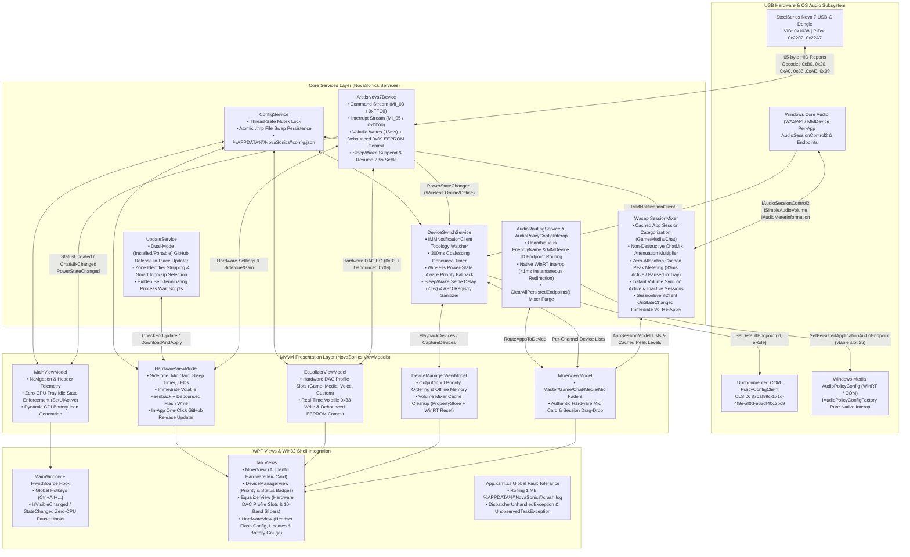

# NovaSonics Technical Architecture

**NovaSonics** is a high-performance, native Windows (.NET 8.0 WPF) system tray daemon and desktop audio control center designed to completely replace SteelSeries GG / Sonar for the **SteelSeries Arctis Nova 7** wireless headset family. Unlike SteelSeries Sonar—which installs multiple kernel-mode virtual audio drivers (VADs) and high-overhead background telemetry—NovaSonics operates directly on top of native Windows Core Audio APIs (**WASAPI** / **MMDevice** / **IPolicyConfig** / **AudioPolicyConfig** WinRT) and direct **USB HID** hardware communication (`HidSharp`).

---

## 1. High-Level System Overview & Data Flow

---

## 2. Hardened Service, ViewModel & Interop Breakdown

### 2.1 Core Services (`NovaSonics/Services/`)

#### 1. `ArctisNova7Device.cs` (USB HID Hardware Driver & Flash Wear Protection)
Manages low-level, lock-synchronized (`_ioLock`) USB HID communication with the SteelSeries Arctis Nova 7 wireless transceiver via `HidSharp`.
* **Dual-Interface Discovery (`TryConnect`)**:
  * Enumerates all HID devices matching Vendor ID `0x1038` and supported Nova 7 Product IDs (`SupportedPids`), falling back to product name matching (`"Arctis Nova 7"`).
  * **Command Interface (`_commandStream`)**: Selected by matching path tokens `mi_03` and `col01` (or HID Report Descriptor `UsagePage == 0xFFC0 && Usage == 0x0001`), requiring `GetMaxOutputReportLength() == 65`. Used for request/response queries and writing hardware registers.
  * **Async Interrupt Interface (`_syncStream`)**: Selected by matching path tokens `mi_03` and `col02` (or `UsagePage == 0xFF00`). Used for real-time hardware dial and state interrupts pushed by the dongle when the user rotates the physical ChatMix wheel or toggles headset power.
* **EEPROM Flash Wear Protection (`0x09` Decoupling)**:
  * Register modifications (Hardware Mic Volume `0x37`, Sidetone `0x39`, Volume Limiter `0x3A`, Auto-Shutoff `0xA3`, Mic Mute LED `0xAE`, 10-Band EQ `0x33`) execute via `SendWriteRegister` with a minimal `15ms` settle delay, writing directly into the headset's volatile RAM.
  * Dragging sliders produces zero flash wear. A single thread-safe debounced timer (`_flashCommitDebounceTimer`, `2500ms`) automatically issues the expensive `0x09` EEPROM commit once user adjustments settle.
  * An explicit commit method `CommitToFlashAsync()` is exposed for immediate "Save to Headset" button clicks.
* **Sleep/Wake & USB Disconnect Resilience**:
  * Subscribes to `Microsoft.Win32.SystemEvents.PowerModeChanged`.
  * On `PowerModes.Suspend`: Sets `_isSuspended = true` and closes all HID streams immediately so the PC suspends without hanging USB root hubs.
  * On `PowerModes.Resume`: Implements a `2500ms` settle delay allowing USB Root Hubs to power up and re-enumerate, clears suspend flags, re-opens HID streams, and re-syncs initial hardware state.
* **Adaptive Polling Interval**:
  * Polling runs at `1000ms` when the headset is online and backs off to `2000ms` when offline. Interrupts for physical ChatMix dial movement (`0x45`), battery changes (`0xB7`), power state (`0xB9`), and charging state (`0xBB`) are delivered in real time by `_syncStream`.

#### 2. `WasapiSessionMixer.cs` (Per-App WASAPI Mixer & Zero-CPU Engine)
Replaces virtual audio cables by dynamically attenuating individual Windows WASAPI audio sessions (`AudioSessionControl`) on the active default render endpoint and secondary devices.
* **Channel Virtualization**:
  * Categorizes every active audio process into one of three logical channels: `AppChannel.Game`, `AppChannel.Chat`, or `AppChannel.Media` (plus `Master` and `Mic` endpoint controls).
  * Default categorization heuristics assign voice clients (`discord`, `ts3client_win64`, `teamspeak`, `mumble`, `slack`, `teams`, `zoom`, `skype`, `vencord`, `vesktop`) to `Chat`, media players and browsers (`spotify`, `chrome`, `msedge`, `firefox`, `brave`, `opera`, `vlc`, `mpv`, `mpc-hc64`, `foobar2000`, `musicbee`, `tidal`, `deezer`) to `Media`, and all games / notifications to `Game`.
* **Non-Destructive ChatMix Attenuation Formula**:
  * Base channel volumes (`GameVolume`, `MediaVolume`, `ChatVolume`) are preserved intact when the ChatMix wheel moves.
  * Given `ChatMixBalance` $B \in [-1.0, +1.0]$:
    $$\text{gameAtten} = B > 0 ? \text{Clamp}(1.0 - B, 0, 1) : 1.0$$
    $$\text{chatAtten} = B < 0 ? \text{Clamp}(1.0 + B, 0, 1) : 1.0$$
  * Effective session volumes:
    * `Game`: $\text{GameMuted} ? 0 : \text{Clamp}(\text{GameVolume} \times \text{gameAtten}, 0, 1)$
    * `Media`: $\text{MediaMuted} ? 0 : \text{Clamp}(\text{MediaVolume} \times \text{gameAtten}, 0, 1)$
    * `Chat`: $\text{ChatMuted} ? 0 : \text{Clamp}(\text{ChatVolume} \times \text{chatAtten}, 0, 1)$
* **Instant Volume Sync on Inactive Sessions & `SessionEventClient`**:
  * `ApplyVolumes()` writes scalar volumes to both `Active` and `Inactive` (paused) sessions immediately. Pausing Spotify, moving ChatMix, and unpausing Spotify resumes at the exact attenuated volume without a 1-second loud volume pop.
  * Each session registers an `IAudioSessionEventsHandler` (`SessionEventClient`) that intercepts `OnStateChanged`; when an audio session transitions to `AudioSessionStateActive`, `ApplyVolumes()` is re-executed immediately.
* **Zero-CPU Tray Idle (`SetActive(false)`)**:
  * When the main window is minimized, hidden to the system tray, or on another tab, `SetActive(false)` completely stops the 33ms `_peakTimer`, zeroes all live peak properties, and backs off session refresh polling from 1s to 5s, achieving true `0.0%` idle CPU usage.
* **Unmanaged GDI Leak Prevention & Process Pruning**:
  * Extracted window and executable icons are converted to `BitmapSource` and immediately invoke `[DllImport("user32.dll")] DestroyIcon(hIcon)` in a `finally` block, followed by `.Freeze()`, guaranteeing zero GDI object count growth.
  * During session refresh, process lifetimes are verified (`proc.HasExited`). Terminated processes and inactive transient console sessions (`cmd`, `powershell`, `conhost`, `wt`) are pruned from the UI within 1 second.
  * Friendly name resolution strips raw executable paths and Win32 DLL resource strings (`@%SystemRoot%...`), resolving clean process titles (e.g., `cmd` $\rightarrow$ `"Command Prompt"`, `explorer` $\rightarrow$ `"Windows Explorer"`).

#### 3. `DeviceSwitchService.cs` (Endpoint Priority & Topology Engine)
Implements `IMMNotificationClient` to monitor Windows audio endpoint topology changes and enforce user-defined priority lists.
* **Synchronous `RefreshDevices()` Architecture**:
  * Returns `List<AudioDeviceModel>` directly and synchronously so background threads (e.g. `HandleHeadsetPowerStateChanged`, `OnTopologyChangedDebounced`, and `EnforcePriorityDevice`) can evaluate online devices immediately without awaiting or racing UI thread `Dispatcher.BeginInvoke` dispatches.
* **300ms Coalescing Debounce Timer**:
  * Windows audio endpoint notifications (`OnDeviceStateChanged`, `OnDeviceAdded`, `OnDeviceRemoved`) often arrive in bursts of 5–15 events. Rapid events are coalesced into a single 300ms debounce timer (`_topologyDebounceTimer`), eliminating thread contention and race conditions.
* **Smart Priority Auto-Switching vs. Manual Defaults**:
  * Tracks `_knownOnlineDeviceIds` across topology passes. Auto-switching only switches to a higher-priority device if that device is **newly connected** (transitioned from offline to online). General topology notifications do not revert manual user device selections.
  * Clicking **"Set Default"** on any online device promotes it to index 0 of `PriorityDevices`, saves the list synchronously, and executes an immediate system-wide role switch via `IPolicyConfigClient` (`eConsole`, `eMultimedia`, `eCommunications`).
* **Wireless Power-State Integration & Channel Follow**:
  * The Nova 7 USB dongle remains present in Windows even when the headset is turned off. `DeviceSwitchService` correlates Windows device availability with the headset's physical wireless power state (`PowerStateChanged`).
  * When the headset turns on, it takes over as default output and default communications capture device. When `UseSameDeviceOnAllChannels` is true, all mixer channel faders (Master, Game, Media, Chat) synchronously follow the new default device.
  * When the headset turns off, output automatically falls back to the highest-priority online alternative (e.g., desktop speakers or monitor), and capture falls back to the desktop microphone.
* **Sleep/Wake Suppression**:
  * Subscribes to `PowerModeChanged`. During `PowerModes.Suspend`, all endpoint fallback actions and toasts are suppressed. On `PowerModes.Resume`, a `2500ms` settle delay ensures Bluetooth and USB audio stacks have stabilized before priority checks occur.
* **Registry PropertyStore Sanitizer & Application Unpinning (`PurgeStalePropertyStoreKeys`)**:
  * When `UseSameDeviceOnAllChannels` is enabled (default) or when clicking `Clean Volume Mixer`, purges application-specific override keys (`.exe` or `\Device\HarddiskVolume`) from `HKCU\Software\Microsoft\Internet Explorer\LowRegistry\Audio\PolicyConfig\PropertyStore`.
  * Also issues `AudioPolicyConfigInterop.ClearAllPersistedEndpoints()` to immediately clear Windows Runtime per-application routing, ensuring all applications instantly follow the active system default device without ghost entries.

#### 4. `AudioRoutingService.cs` & `AudioPolicyConfigInterop.cs` (100% Pure Native WinRT Routing)
Routes individual mixer channels (`Game`, `Media`, `Chat`, `Mic`) to specific physical hardware endpoints when `Sync all channels with default device` is unchecked.
* **100% Native COM / WinRT Interop**: Replaces all external helper binaries with direct Windows Runtime activation of `Windows.Media.Internal.AudioPolicyConfig` via `combase.dll!RoGetActivationFactory`.
* **Multi-Build Compatibility**: Automatically resolves `IAudioPolicyConfigFactory` across Windows 10 and Windows 11 builds (`ab3d4648-e242-459f-b02f-541c70306324`, `2a59116d-6c4f-45e0-a74f-707e3fef9258`, `a668fb11-7e5a-40e2-830d-6835b39b8798`).
* **VTable Layout**:
  * **Slot 25**: `SetPersistedApplicationAudioEndpoint(this, pid, flow, role, hstring)`
  * **Slot 26**: `GetPersistedApplicationAudioEndpoint(this, pid, flow, role, out hstring)`
  * **Slot 27**: `ClearAllPersistedApplicationEndpoints(this)`
* **Device ID Format**: Formats standard MMDevice IDs into Windows Software Device (`SWD`) endpoint representations:
  * Render: `\\?\SWD#MMDEVAPI#{mmDeviceId}#{e6327cad-dcec-4949-ae8a-991e976a79d2}`
  * Capture: `\\?\SWD#MMDEVAPI#{mmDeviceId}#{2eef81be-33fa-4800-9670-1cd474972c3f}`
* **Sub-Millisecond Performance**: Redirection executes in `<1ms` in pure C# memory with zero child process overhead, zero disk writes, and zero console flashes.

#### 5. `ConfigService.cs` (Thread-Safe Atomic File Persistence & Validation)
* Persists configuration to `%APPDATA%\NovaSonics\config.json` with a `.bak` backup copy (`config.bak.json`).
* Uses a dedicated `_fileLock` object, `FileStream.Flush(flushToDisk: true)`, and an atomic `.tmp` swap file write pattern (`File.Copy(configPath, bakPath, true); File.Move(tmpPath, configPath, overwrite: true)`), completely preventing file corruption during sudden system shutdowns.
* Runs `NovaSonicsConfig.ValidateAndSanitize()` on `Load`, `Save`, `Export`, and `Import` to clamp all volume/balance/hardware fields, validate 10-band EQ arrays, and initialize null collections.

#### 6. `UpdateService.cs` (Dual-Mode In-App GitHub Release In-Place Updater)
Provides fully autonomous, one-click in-place application updates for both Installed (`Inno Setup`) and Portable (`ZIP`) installations directly from the Settings tab:
* **Installation Mode Detection**:
  * Detects presence of `unins000.exe` in `AppContext.BaseDirectory` to identify `IsInstalledVersion`.
  * Exposes `CurrentVersionDisplay` (e.g. `v1.1.1 (Installed)` or `v1.1.1 (Portable)`).
* **GitHub Releases API Query**:
  * Queries `https://api.github.com/repos/brazaoo4/novasonics/releases/latest` with a 10s timeout and `User-Agent: NovaSonics-Updater`.
  * Dynamically selects the proper release asset: `*Setup*.exe` for Installed builds or `*Portable*.zip` for Portable builds.
  * Compares remote release tag (`vX.Y.Z`) against executing assembly version.
* **Dual-Mode Download & Apply Architecture**:
  * Streams payload with progress reporting (`IProgress<double>`) into `%TEMP%` using an 80 KB buffer.
  * Automatically strips the NTFS `Zone.Identifier` alternate data stream to bypass Windows SmartScreen extraction and execution locks.
  * **Installed Branch**: Generates a self-terminating PowerShell script (`novasonics_update_installed.ps1`) that waits up to 10 seconds for the current process PID to release mutex and file locks, executes the Inno Setup installer with `/SILENT /SUPPRESSMSGBOXES /NORESTART /CLOSEAPPLICATIONS` (elevating with `-Verb RunAs` if installed under Program Files), relaunches `NovaSonics.exe`, and cleans up.
  * **Portable Branch**: Extracts archive to `%TEMP%\NovaSonics_Portable_Staging`, dynamically discovers the payload directory containing `NovaSonics.exe`, generates a hidden PowerShell script (`novasonics_update_portable.ps1`) that waits for process termination, overwrites files into the target folder via `Copy-Item -Recurse -Force`, cleans staging files, and relaunches `NovaSonics.exe`.
  * Initiates clean application shutdown via `App.ExitApplication()`, disarming tray-minimize cancellation.
* **Fallback Script**: Standalone `Scripts/update-portable.ps1` bundled inside portable releases for manual CLI-based updates.

---

## 3. Threading Model

| Thread / Execution Context | Origin & Frequency | Responsibilities | Synchronization & Marshaling |
| :--- | :--- | :--- | :--- |
| **UI Dispatcher Thread (STA)** | Main WPF Thread + `MainViewModel._uiTimer` (33ms, paused in tray) | Renders XAML views, processes user slider interactions, handles Win32 `WndProc` hotkeys (`WM_HOTKEY`), updates `ObservableCollection` bindings, draws GDI battery tray icons, owns `WasapiSessionMixer` `MMDevice` COM apartment. | Uses re-entrancy guards (`_isUpdatingFromService`, `_isExternalUpdate`). UI timers pause during tray minimization. |
| **HID Polling Thread** | `ArctisNova7Device.PollingLoop` (Background task, 1000ms online / 2000ms offline) | Sends `0xB0` status every 1s (online) or 2s (offline), and `0x20` audio / `0xA0` UX config requests on connect and every 5s while online. Detects wireless power transitions. | Synchronized via `lock (_ioLock)` around `_commandStream`. Pauses on `PowerModes.Suspend`. |
| **HID Interrupt Thread** | `ArctisNova7Device.AsyncEventReaderLoop` (Background task, blocking read) | Reads asynchronous 65-byte interrupt packets from `_syncStream` (`0x45` ChatMix dial, `0xB7` battery, `0xB9` power, `0xBB` charging). | Dedicated handle (`_syncStream`); updates `Status` and dispatches events via `Dispatcher.BeginInvoke`. |
| **WASAPI Session Timers** | `DispatcherTimer` (`_peakTimer` @ 33ms, `_sessionRefreshTimer` @ 1000ms active / 5000ms tray) | Zero-allocation peak meter reads from cached session instances; enumerates sessions and checks process exit status. | Synchronized via `lock (_sessionLock)` and STA thread affinity inside `WasapiSessionMixer`. Paused when app is minimized or hidden. |
| **CoreAudio COM Callbacks (MTA)** | OS-managed `IMMNotificationClient` & `IAudioSessionEventsHandler` | Intercepts `OnDeviceStateChanged`, `OnDeviceAdded`, `OnDeviceRemoved`, `OnDefaultDeviceChanged`, and `OnStateChanged`. | Coalesced via 300ms `_topologyDebounceTimer` and protected by `_isSwitchingEndpoint` / `_switchCooldownExpiry` guards. Dispatches updates to UI STA thread via non-blocking `BeginInvoke`. |
| **Flash Commit Timer** | `System.Threading.Timer` (`2500ms` debounce) | Issues `0x09` EEPROM flash commit only after slider adjustments settle. | Synchronized via `lock (_flashTimerLock)` and `lock (_ioLock)`. |

---

## 4. Hardware DAC Equalizer Specification

The Arctis Nova 7 wireless transceiver features a 10-band hardware digital-to-analog converter (DAC) equalizer. Equalization is processed directly on the headset DSP and applies globally to all physical audio streams:

* **Frequency Bands (10)**: `31 Hz`, `62 Hz`, `125 Hz`, `250 Hz`, `500 Hz`, `1 kHz`, `2 kHz`, `4 kHz`, `8 kHz`, `16 kHz`.
* **Gain Range**: $-10.0\text{ dB}$ to $+10.0\text{ dB}$ (in $0.5\text{ dB}$ increments).
* **Hardware Encoding**:
  $$\text{byteValue} = \text{round}(2 \times (10.0 + \text{gainDb})) \in [0..40] \quad (\text{where } 0.0\text{ dB} = 20 = \text{0x14})$$
* **Profile Slots**:
  * `🎮 GAME`: Competitive tuning (Smiley FPS, Deep Bass, Footsteps / Focus, Flat).
  * `🎵 MEDIA`: Music and cinematic tuning (Music Bass, Movie Immersion, Vocal Clarity, Flat).
  * `🎙️ VOICE`: Communication tuning (Voice Clarity, Warm Voice, Podcast / Broadcast, Flat).
  * `⚙️ CUSTOM`: Fully customizable 10-band curve.
* **Volatile vs. Non-Volatile Commits**:
  * Adjusting any slider sends opcode `0x33` immediately with a 15ms delay into headset volatile RAM for zero-latency feedback.
  * Opcode `0x09` is debounced by 2.5 seconds or triggered explicitly via `Save to Headset`.

---

## 5. Hardware & OS Constants Reference

### 5.1 USB HID Identifiers (`ArctisNova7Device.cs`)
* **Vendor ID (`VendorId`)**: `0x1038` (SteelSeries ApS)
* **Supported Product IDs (`SupportedPids`)**:
  * `0x2202`: Arctis Nova 7 (Gen 1 Default / PC)
  * `0x2206`: Arctis Nova 7X (Gen 1 Xbox/PC)
  * `0x220A`: Arctis Nova 7P (Gen 1 PlayStation/PC)
  * `0x227E`: Arctis Nova 7 (Gen 2)
  * `0x2298`: Arctis Nova 7P (Gen 2)
  * `0x229E`: Arctis Nova 7X (Gen 2)
  * `0x22A1`: Arctis Nova 7 (Upgrade Edition Transceiver - Active Hardware)
  * `0x22A5`: Arctis Nova 7X (Upgrade Edition)
  * `0x22A7`: Arctis Nova 7P (Upgrade Edition)
* **Legacy 0–4 Battery Scale PIDs (`LegacyBatteryScalePids`)**:
  * `0x2202`, `0x2206`, `0x220A`, `0x223A`, `0x2258`, `0x227A`. These return `0..4` in `resp[3]` (multiplied by `25` for `0..100%`), whereas newer firmware (`0x22A1`, `0x227E`) returns direct `1..100%`.
* **HID Report Framing**:
  * Packet length: `65` bytes (`byte[0] = 0x00` Report ID, `byte[1] = Opcode`, `byte[2..64] = Payload`).
  * Command Interface (`_commandStream`): `MI_03` / `Col01` (`UsagePage: 0xFFC0`, `Usage: 0x0001`), Read/Write Timeout = `500ms`.
  * Interrupt Interface (`_syncStream`): `MI_03` / `Col02` (`UsagePage: 0xFF00`, `Usage: 0x0001`), Read Timeout = `1000ms`.

### 5.2 USB HID Opcodes & Byte Layouts

| Opcode | Direction | Function | Payload Layout (`byte[]` 1-indexed after Report ID `0x00`) |
| :--- | :--- | :--- | :--- |
| `0xB0` | R/W Query | Read Status, Battery & ChatMix | **Req**: `[0x00, 0xB0]` **Resp**: `[2]` = ConnState (`0..2` Offline, `3` Online), `[3]` = Battery (`1..100` or `0..4`), `[4]` = Charging (`1` = Charging), `[5]` = Game Atten (`0..100`), `[6]` = Chat Atten (`0..100`) |
| `0x20` | R/W Query | Read Audio Hardware Registers | **Req**: `[0x00, 0x20]` **Resp**: `[2]` = Mic Gain (`0..7`), `[3]` = Sidetone (`0` Off, `1` Low, `2` Med, `3` High), `[4]` = Volume Limiter (`0` Off, `1` On) |
| `0xA0` | R/W Query | Read UX Hardware Registers | **Req**: `[0x00, 0xA0]` **Resp**: `[2]` = Sleep Timer Minutes (`0..255`), `[3]` = Mic Mute LED Brightness (`0` Off, `1` Low, `2` Med, `3` High) |
| `0x33` | Write | Write Hardware DAC Equalizer | • **Gen 1 (`0x2202`)**: `[0x00, 0x33, b0..b9, 0x00]` (10 graphic bands, `round(2 * (10.0 + dB))` $\in [0..40]$). • **Gen 2 / Upgrade (`0x22A1`, `0x227E`)**: 4-packet Parametric EQ sequence: (1) `0xA7` Name (`connection_type = 0x00` 2.4G, `0x01` BT, `0x02` Mic), (2) `0x33` PEQ (10 bands of `uint16 freq LE, uint8 filter_type 1, int8 gain*10, uint16 q_factor 1414 LE`), (3) `0x27` Update Complete, (4) `0x09` Flash Commit. |
| `0x37` | Write | Set Hardware Mic Gain | **Req**: `[0x00, 0x37, level]` (`level` $\in [0..7]$, default `7` = 100% hardware mic gain; `0` = silent preamp) |
| `0x39` | Write | Set Hardware Sidetone | **Req**: `[0x00, 0x39, level]` (`level` $\in [0..3]$) |
| `0x3A` | Write | Set EU Volume Limiter | **Req**: `[0x00, 0x3A, enabled]` (`0x00` or `0x01`) |
| `0xA3` | Write | Set Auto-Shutoff Timer | **Req**: `[0x00, 0xA3, minutes]` (`minutes` $\in [0..255]$) |
| `0xAE` | Write | Set Muted Mic LED Brightness | **Req**: `[0x00, 0xAE, brightness]` (`brightness` $\in [0..3]$) |
| `0x09` | Write | Commit Registers to EEPROM Flash | **Req**: `[0x00, 0x09]` (Preceded by `30ms` settle delay; followed by `1500ms` firmware block delay). |
| `0x45` | Interrupt | Physical ChatMix Dial Turned | **Event (`_syncStream`)**: `[2]` = Game Atten (`0..100`), `[3]` = Chat Atten (`0..100`) |
| `0xB7` | Interrupt | Battery Level Changed | **Event (`_syncStream`)**: `[2]` = Battery Level |
| `0xB9` | Interrupt | Headset Wireless Power Changed | **Event (`_syncStream`)**: `[2]` = Connection State (`0x03` = Online, `0x02` = Offline) |
| `0xBB` | Interrupt | Charging State Changed | **Event (`_syncStream`)**: `[2]` = Charging (`0x01` = Charging) |

### 5.3 Windows COM, WinRT & Win32 Constants
* **Single-Instance Synchronization (`App.xaml.cs`)**:
  * Mutex: `Global\NovaSonics_SingleInstance_Mutex`
  * Wake Event: `Global\NovaSonics_ShowWindow_Event` (`EventWaitHandle`)
* **`PolicyConfigClient` CLSID**: `870af99c-171d-4f9e-af0d-e63df40c2bc9`
* **`IPolicyConfig` IID (Win10/11)**: `f8679f50-850a-41cf-9c72-430f290290c8`
* **`IPolicyConfigVista` IID (Fallback)**: `568b9108-44bf-40b4-9006-86afe5b5a620`
* **WinRT `AudioPolicyConfig` Class ID**: `"Windows.Media.Internal.AudioPolicyConfig"`
* **`IAudioPolicyConfigFactory` IIDs**:
  * `ab3d4648-e242-459f-b02f-541c70306324` (Windows 10 20H1+ / Windows 11 21H2–24H2+)
  * `2a59116d-6c4f-45e0-a74f-707e3fef9258` (Windows 10 1809–1909)
  * `a668fb11-7e5a-40e2-830d-6835b39b8798` (Windows 11 Insider / newer builds)
* **Global Hotkeys (`MainWindow.xaml.cs`, `MOD_CONTROL | MOD_ALT = 0x0003`)**:
  * `9001` (`Ctrl+Alt+Up`, `0x26`): Master Volume `+5%`
  * `9002` (`Ctrl+Alt+Down`, `0x28`): Master Volume `-5%`
  * `9003` (`Ctrl+Alt+Left`, `0x25`): Shift ChatMix toward Game (`-10%`)
  * `9004` (`Ctrl+Alt+Right`, `0x27`): Shift ChatMix toward Chat (`+10%`)
  * `9005` (`Ctrl+Alt+M`, `0x4D`): Toggle Microphone Mute
